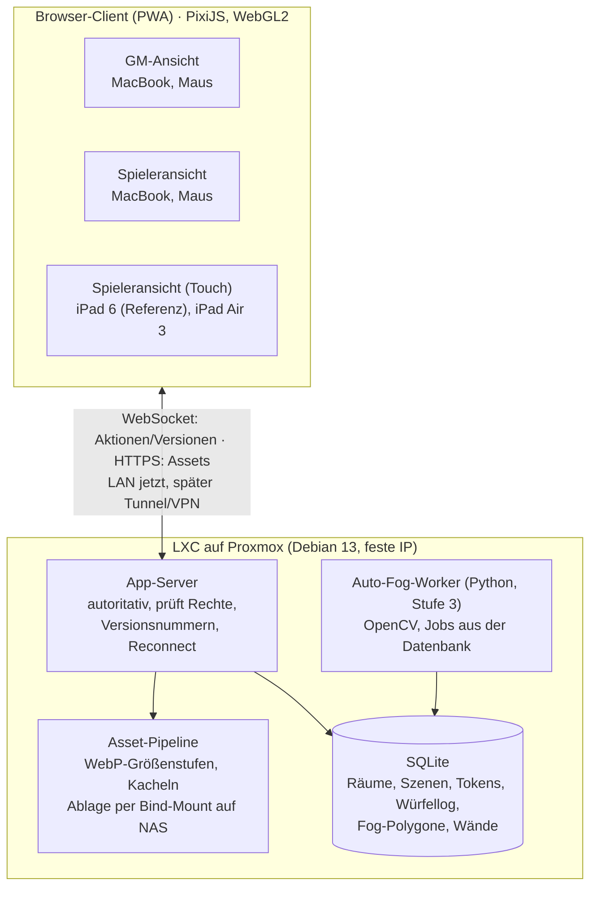

# Mistwarden – Spezifikation

Stand: 22.10.2026

## Ziel und Rahmen

Mistwarden ist ein selbst gehosteter, schlanker Ersatz für Owlbear Rodeo: eine Runde (GM + 4 Spieler) spielt Curse of Strahd: Reloaded damit am Tisch, später optional online. Maßstab ist nicht Feature-Gleichstand mit Owlbear, sondern: keine Upload-Limits, kein Abo, Daten bleiben im Homelab, nur was die Runde wirklich nutzt. Das Projekt wird als Open Source veröffentlicht, damit andere es ebenfalls selbst hosten können.

**Rahmenbedingungen**

- Eigener Betrieb auf dem Proxmox-Server als plain LXC (Debian 13, feste IP). Für andere Nutzer zusätzlich ein optionales Docker-Setup.
- Auch im lokalen Netz nur über HTTPS (z. B. Reverse Proxy mit eigener Domain und Let's-Encrypt-DNS-Challenge): Service Worker und weitere Browser-APIs funktionieren nur in sicheren Kontexten.
- Jetzt: Spiel am Tisch im lokalen Netz. Später: Online-Spiel – Architektur muss das von Anfang an tragen, ohne LAN-Annahmen fest einzubauen.
- Entwicklung mit Claude Code; ein Entwickler, kein Team.
- Karten kommen aktuell von Patreon-Creators; wo verfügbar, auch als Universal-VTT-Export (.dd2vtt).

**Bewusst nicht im Umfang**

- Regelautomatik in Charakterbögen (Zauberplätze, Zustände, Rasten, Stufenaufstieg, Klassenmerkmale).
- Import aus D&D Beyond.
- Extension-/Plugin-System.
- Cast-Funktion auf TV (ein Browser-Tab im Vollbild reicht).
- Mitgelieferte Token- und Kartenpakete.
- Schutz gegen Schummeln über die Entwicklertools: Kartenbild und Wanddaten liegen vollständig im Client, auch unter dem Fog. Bewusst akzeptiert und in der README als bekannte Einschränkung dokumentiert.

## Geräte und Referenzgerät

Das iPad der 6. Generation ist das Referenzgerät: Es bleibt dauerhaft auf iPadOS 17 (Safari 17, A10, 2 GB RAM). Alles muss dort flüssig laufen, sonst gilt es als nicht fertig.

| Gerät | Rolle | Eingabe | System / Browser | Einordnung |
| --- | --- | --- | --- | --- |
| MacBook Pro M5 | GM | Maus, Tastatur | macOS | unkritisch |
| MacBook Pro M1 Pro | Spielerin | Maus, Tastatur | macOS | unkritisch |
| iPad Air 3. Gen | Spieler | Touch | iPadOS 26, WebKit | unkritisch (A12, 3 GB RAM) |
| iPad 6. Gen (2018) | Spieler | Touch | iPadOS 17, Safari 17 | **Referenzgerät** |

**Technische Grenzen aus dem Referenzgerät**

- Rendering über WebGL2; kein WebGPU.
- Alle Browser auf iPads nutzen WebKit – eine Engine zum Testen.
- Speicher ist der Engpass: Karten werden nie in voller Auflösung als eine Textur geladen (siehe Datenmodell, Assets). Maximale Texturgröße beim Start per WebGL abfragen, nicht annehmen.
- Safari kappt WebSockets bei Displaysperre oder im Hintergrund – Reconnect ist Pflicht.

**Definition of Done für jedes Feature**

1. Funktioniert auf dem iPad 6 per Touch.
2. Funktioniert auf dem Laptop mit Maus (Rechtsklick statt langem Drücken, Mausrad zum Zoomen).
3. Synchronisiert korrekt zwischen GM und mindestens zwei Spielern.
4. Übersteht ein Neuladen bzw. Reconnect ohne Datenverlust.

## Architektur und Tech-Stack

Alle Geräte sprechen nur mit dem App-Server; Datenbank, Asset-Pipeline und Auto-Fog-Worker laufen gemeinsam im LXC.

| Schicht | Wahl | Grund |
| --- | --- | --- |
| Frontend | TypeScript, PixiJS (WebGL2), PWA | Shader für Wetter und Fog, große Karten, läuft auf iPadOS 17 |
| Backend | Node.js LTS, WebSocket | ein Stack mit dem Frontend; stabil auf Debian, breite Bibliotheksbasis |
| Datenbank | SQLite im WAL-Modus | eine Runde, ein Server; regelmäßiges Backup über den SQLite-Backup-Befehl (vzdump allein kann eine laufende Datenbank inkonsistent sichern) |
| Geometrie | Clipper2 als JS- oder WASM-Port (Port und dessen Lizenz prüfen), Sichtpolygon per Raycasting | Fog-Operationen und dynamischer Fog auf demselben Modell |
| Auto-Fog | Python, OpenCV; optional Segmentierungsmodell | Batch-Job, CPU bzw. iGPU reicht |
| Betrieb | plain LXC, Debian 13, feste IP | entspricht den bestehenden Homelab-Konventionen |

## Datenmodell

Fog und Wände sind von Anfang an Vektordaten (Polygone), nie Pixelmasken. Das ist die wichtigste Entscheidung des Projekts: Fog-Werkzeuge, dynamischer Fog, .dd2vtt-Import und Auto-Fog schreiben und lesen alle dasselbe Modell.

| Objekt | Wichtige Felder | Hinweise |
| --- | --- | --- |
| Raum | id, Name, geheimer Spieler-Link, GM-Passwort-Hash | Spieler ohne Account, nur über Link |
| Spieler | id, Anzeigename, Farbe, Raum | Sitzungs-Token im Browser, überlebt Reload |
| Szene | id, Raum, Name, Grid (Quadrat/Hex, Größe, Offset), Wetter-Parameter | mehrere Szenen pro Raum |
| Ebene | Karte, Props, Tokens, Notizen, Zeichnungen | feste Reihenfolge |
| Kartenbild | Asset-Referenz, Position, Maßstab | Anzeige über Größenstufen/Kacheln |
| Token | id, Asset, Position, Größe, Rotation, Besitzer, versteckt, HP, Status-Marker, Bogen-Verknüpfung, Sicht an/aus, Sichtradius | Spieler bewegen nur eigene Tokens |
| Fog-Form | Polygon (mit Löchern), sichtbar an/aus, Quelle (Hand, Import, Auto) | boolesche Operationen über Clipper2 |
| Wand | Liniensegment, Typ (Wand, Tür offen/zu, Fenster) | aus Fog-Kanten abgeleitet oder importiert |
| Notiz | Text, Position, nur GM / alle | GM-Notizen auf der Karte |
| Handout | Bild oder Text, Empfänger (alle / einzelne Spieler) | |
| Charakterbogen | Spieler, Attribute, abgeleitete Modifikatoren, HP, RK, Inventar, Notizen, Würfel-Aktionen | keine Regelautomatik |
| Würfelwurf | Zeit, Spieler, Formel, Ergebnis, verdeckt ja/nein | Log pro Raum |
| Asset | Datei, Typ, Tags, Größenstufen, Kacheln | Original bleibt erhalten |

**Assets und Kartengröße**

- Beim Upload erzeugt der Server WebP-Varianten in mehreren Größen (z. B. 1024, 2048, 4096 px Kantenlänge) und bei sehr großen Karten Kacheln.
- Der Client wählt die Stufe nach seiner abgefragten maximalen Texturgröße und dem Zoom.
- Speicherort: Bind-Mount auf das NAS, nicht in den Container. Pfad per Konfiguration.

**Synchronisation**

- Der Server ist autoritativ: Clients senden Aktionen, der Server prüft Rechte, speichert und verteilt.
- Jede Änderung bekommt eine fortlaufende Versionsnummer; ein Client holt nach Reconnect nur die fehlenden Änderungen.
- Verdeckte Objekte (versteckte Tokens, GM-Notizen, verdeckte Würfe, fremde Handouts) werden an Spieler gar nicht ausgeliefert. Ausnahme: Kartenbilder und Wände (siehe „Bewusst nicht im Umfang“).

## Stufe 1 – spielbar

Ziel: eine komplette Session am Tisch damit leiten. Grobe Schätzung 2–4 Wochenenden (ungeprüfte Annahme).

| Feature | Akzeptanzkriterium |
| --- | --- |
| GM-Login, Raum anlegen, Spieler-Link | GM loggt sich mit Passwort ein; Spieler treten per Link mit Namen bei, ohne Account. |
| Mehrere Szenen pro Raum | GM wechselt die Szene; alle Clients folgen innerhalb von 1 s. |
| Karte hochladen + Grid | Quadrat- und Hex-Grid; Größe und Offset manuell einstellbar; große Karten laden auf dem iPad 6 ohne Absturz. |
| Tokens | Hochladen, ziehen, am Grid einrasten, skalieren, drehen; Spieler bewegen nur eigene Tokens. |
| Ebenen | Karte, Props, Tokens, Notizen, Zeichnungen in fester Reihenfolge; Karte gegen versehentliches Verschieben gesperrt. |
| Versteckte Tokens, GM-Notizen | Für Spieler unsichtbar und nicht im Netzwerkverkehr enthalten. |
| Statischer Fog | Polygon- und Pinselwerkzeug; Formen einzeln an/aus; GM sieht Fog halbtransparent, Spieler deckend. |
| Echtzeit-Sync | Bewegung eines Tokens erscheint auf allen Geräten in unter 300 ms im LAN. |
| Reconnect | Nach Displaysperre oder WLAN-Wechsel verbindet der Client automatisch neu und holt den aktuellen Stand. |
| Ping/Pointer | Langes Drücken bzw. Klick erzeugt einen für alle sichtbaren Ping. |
| Messwerkzeug | Distanz in Feldern und Fuß (Standard 5 ft pro Feld); Einheit und Diagonalregel pro Szene einstellbar. |
| Freihandzeichnen | Linien und Formen, löschbar, pro Spieler-Farbe. |
| Würfel + Log | Würfelformeln (z. B. 1d20+5, 4d6kh3); Log mit Verlauf; GM kann verdeckt würfeln. |
| Handouts | GM zeigt Bild oder Text allen oder einzelnen Spielern. |
| Rückgängig/Wiederholen | Mindestens für Token-Bewegung, Fog und Zeichnungen. |
| Touch + Maus | Pinch-Zoom und Ziehen auf dem iPad; Mausrad und Rechtsklick auf dem Laptop. |
| PWA | Auf dem iPad zum Home-Bildschirm hinzufügbar, startet im Vollbild; läuft über HTTPS. |
| Raum-Export | Ein Raum lässt sich als Datei exportieren und wieder importieren. |

## Stufe 2 – Komfort, Sicht, Wetter, Bögen

Ziel: funktional nah an Owlbear 2.x plus dessen beliebteste Erweiterungen. Grobe Schätzung 4–8 Wochenenden (ungeprüfte Annahme).

| Feature | Akzeptanzkriterium |
| --- | --- |
| Fog-Operationen Fit, Trim, Join, Overlay | Neue Form kann bestehende Formen beschneiden oder mit ihnen verschmelzen. |
| Shape Snapping | Ecken neuer Fog-Formen rasten an vorhandenen Ecken und Kanten ein. |
| Automatische Grid-Erkennung | Vorschlag für Größe und Offset beim Karten-Upload, manuell korrigierbar. |
| Import .dd2vtt (Universal VTT) | Kartenbild, Grid, Wände und Türen werden übernommen; Wände erscheinen als Fog-Formen bzw. Wandsegmente. |
| Dynamischer Fog | Token mit aktivierter Sicht deckt per Sichtpolygon auf; Wände blockieren; Türen schaltbar; Neuberechnung nur bei Bewegung. |
| Erkundeter Bereich | Einmal gesehene Bereiche bleiben abgedunkelt sichtbar (optional pro Szene). |
| Wetter | Mindestens Regen, Schnee, Nebel; Windrichtung, Windstärke und Intensität live regelbar; Shader rendert intern in reduzierter Auflösung. |
| Effekte abschaltbar | Jeder Spieler kann Wetter und Effekte auf seinem Gerät ausschalten. |
| Initiative-Tracker | Reihenfolge, aktuelle Runde, aktiver Token hervorgehoben; GM kann Gegner verdeckt eintragen. |
| HP-Balken und Status-Marker | Am Token sichtbar; GM entscheidet pro Token, ob Spieler HP sehen. |
| Charakterbögen | Felder für Attribute, automatisch berechnete Modifikatoren, HP, RK, Inventar, Notizen; HP mit Token verknüpft; Klick auf Fertigkeit oder Angriff würfelt ins Log. |
| Token aus Bild | Bild hochladen, rund oder eckig zuschneiden, Rahmen setzen. |
| Asset-Bibliothek mit Tags | Karten und Tokens nach Tags filtern, raumübergreifend nutzbar. |

Die Wetter-Erweiterung (github.com/owlbear-rodeo/weather) und die Dynamic-Fog-Erweiterung (github.com/owlbear-rodeo/dynamic-fog) stehen unter GPL-3.0 und dürfen in Mistwarden (AGPL-3.0) als Vorlage dienen. Übernommene oder portierte Dateien behalten ihren Copyright-Vermerk (Owlbear Rodeo) und GPL-Hinweis, Änderungen werden markiert. Die Shader sind für Owlbears Effects-System geschrieben und müssen für PixiJS portiert werden.

## Stufe 3 – Auto-Fog-Erkennung

Auto-Fog ist ein Batch-Job pro Karte, kein Echtzeit-Feature: Er läuft einmal nach dem Upload, Laufzeit bis etwa 60 s ist akzeptabel. Er liefert einen Vorschlag aus Fog-Polygonen, den die GM nachkorrigiert – keine perfekte Erkennung als Ziel. Für Karten mit .dd2vtt-Datei entfällt er.

**Vorgehen**

1. Prototyp als eigenständiges Python-Skript, außerhalb der App, getestet an 3–5 echten Karten (lokal, nicht im Repository).
2. Erster Ansatz klassisch mit OpenCV: Wände über Helligkeit bzw. Farbe segmentieren, Konturen finden, mit Douglas-Peucker zu Polygonen vereinfachen. Läuft auf der CPU.
3. Nur wenn das an gemalten Karten oder Höhlen scheitert: Segmentierungsmodell (z. B. SAM 2), ggf. über OpenVINO auf einer Intel-iGPU. Ob es dafür passende Exporte in ausreichender Qualität gibt, ist ungeprüft.
4. Erst wenn der Prototyp auf den Testkarten brauchbare Vorschläge liefert: Einbau als eigener Worker-Dienst.

**Integration**

- Separater Python-Worker (eigener Prozess oder eigener LXC), Aufträge über eine einfache Warteschlange in der Datenbank.
- Ergebnis: Fog-Formen mit Quelle "Auto" im bestehenden Polygon-Modell; GM kann jede Form einzeln übernehmen, ändern oder verwerfen.
- Keine dedizierte GPU vorausgesetzt.

## Vergleich zu Owlbear Rodeo und Risiken

Nach Stufe 2 deckt Mistwarden alles ab, was die Runde von Owlbear nutzt; Owlbear bleibt bei Feinschliff und Touch-Bedienung voraus.

| Bereich | Owlbear Rodeo 2.x | Mistwarden |
| --- | --- | --- |
| Räume, Szenen, Tokens, Grid, statischer Fog | eingebaut | Stufe 1 |
| Handouts an einzelne Spieler | nur über Umwege | Stufe 1 |
| Fog-Operationen, Shape Snapping (seit 2.4) | eingebaut | Stufe 2 |
| Dynamischer Fog (seit 2.3) | offizielle Erweiterung | Stufe 2 |
| Wetter (seit 2.3) | offizielle Erweiterung, GPL-3.0 | Stufe 2 |
| Initiative, HP, Status-Marker | Erweiterungen | Stufe 2, eingebaut |
| Charakterbögen | Erweiterungen | Stufe 2, ohne Regelautomatik |
| .dd2vtt-Import | Erweiterungen | Stufe 2 |
| Auto-Fog ("Forecast", seit 2.4) | eingebaut, läuft auf deren Servern | Stufe 3 |
| Extension-System, Cast, Starter-Sets, GPU-Effekte außer Wetter | eingebaut | nicht geplant |
| Upload-Limits, Abo | abhängig vom Tarif | keine |

**Risiken**

- Umfang: Stufe 3 wird begonnen, bevor Stufe 1 am Tisch getestet ist. Gegenmaßnahme: erste echte Session nach Stufe 1, vor allem anderen.
- Referenzgerät: Entwicklung auf dem MacBook verdeckt Speicherprobleme. Gegenmaßnahme: jedes Feature auf dem iPad 6 abnehmen.
- Renderer-Wechsel: Wer mit einer Canvas-2D-Bibliothek startet, baut für Wetter und dynamischen Fog neu. Gegenmaßnahme: PixiJS ab Tag 1.
- Auto-Fog-Qualität bei gemalten Karten ist unbekannt. Gegenmaßnahme: Prototyp an echten Karten vor jeder Integration.
- Wartung: Abhängigkeiten veralten. Gegenmaßnahme: wenige Abhängigkeiten, nur im LAN bzw. hinter einem Tunnel erreichbar.

**Offene Punkte**

- Online-Zugang später: Cloudflare Tunnel mit GM-Login und geheimem Raum-Link oder Tailscale/WireGuard auf allen Geräten.
- Welche Karten-Creators .dd2vtt-Dateien anbieten.
- Wie aufwendig die Portierung der Owlbear-Wetter-Shader nach PixiJS ist.

Quellen: [Owlbear Rodeo 2.4 – Automatic Fog Detection](https://blog.owlbear.rodeo/owlbear-rodeo-2-4-release-notes/), [Owlbear Rodeo 2.3 – Dynamic Fog](https://blog.owlbear.rodeo/owlbear-rodeo-2-3-release-week-day-3/), [Owlbear Rodeo 2.3 – GPU Effects / Weather](https://blog.owlbear.rodeo/owlbear-rodeo-2-3-release-week-day-4/), [owlbear-rodeo/weather](https://github.com/owlbear-rodeo/weather)

## Arbeitsanweisungen für Claude Code

Diese Datei liegt als SPEC.md im Repository; die Regeln unten zusätzlich in CLAUDE.md.

**Regeln**

- Kein Feature gilt als fertig, bevor es die Definition of Done erfüllt, inklusive Test auf dem iPad 6.
- Fog und Wände ausschließlich als Polygone bzw. Segmente speichern; keine Pixelmasken.
- Renderer ist PixiJS mit WebGL2; keine WebGPU-only-Features.
- Der Server ist autoritativ; Rechte werden serverseitig geprüft; verdeckte Objekte gehen nie an Spieler.
- Keine festen Annahmen über das lokale Netz (Basis-URL konfigurierbar, HTTPS-fähig).
- Abhängigkeiten sparsam; jede neue Abhängigkeit kurz begründen und ihre Lizenz auf AGPL-Kompatibilität prüfen.
- Stufen strikt nacheinander; nichts aus Stufe 3 vor einer echten Session mit Stufe 1.

**Reihenfolge innerhalb von Stufe 1**

1. Projektgerüst, Datenbankschema, WebSocket-Server mit Versionsnummern und Reconnect.
2. Raum, GM-Login, Spieler-Link, Szenen.
3. Asset-Upload mit Größenstufen, Karte und Grid im PixiJS-Renderer.
4. Tokens mit Rechten, Ebenen, Touch- und Mausbedienung.
5. Statischer Fog als Polygone.
6. Würfel und Log, Ping, Messwerkzeug, Zeichnen.
7. Versteckte Tokens, GM-Notizen, Handouts.
8. Rückgängig/Wiederholen, PWA, Raum-Export.
9. Bereitstellung als LXC auf Proxmox mit HTTPS im LAN; Testsession am Tisch.

**Tests**

- Automatisierte Tests für Rechteprüfung, Synchronisation und Polygon-Operationen.
- Manueller Gerätetest nach jedem Schritt: iPad 6, iPad Air 3, MacBook mit Safari.

**Veröffentlichung, Lizenz und Repository**

- Öffentliches Repository `mistwarden-vtt` auf GitHub. Lizenz: AGPL-3.0, LICENSE-Datei ab dem ersten Commit. Wer Mistwarden verändert und als Dienst anbietet, muss seinen Code offenlegen. Alle Abhängigkeiten müssen AGPL-kompatibel sein (MIT, BSD, Apache-2.0, Boost u. ä.); neue Abhängigkeiten vor Aufnahme auf ihre Lizenz prüfen.
- Keine lizenzierten Inhalte im Repository: keine Patreon-Karten, auch nicht in Screenshots oder Demos. Für Demos nur frei lizenzierte (z. B. CC-BY) oder selbst erstellte Karten und Tokens, mit Quellenangabe.
- Keine geschützten Begriffe von Wizards of the Coast oder Owlbear Rodeo in Name oder Oberfläche. In der Dokumentation nur als sachlicher Verweis (Vergleich, Quellenangabe, Lizenzhinweis). Regelbegriffe nur aus dem SRD.
- Fremder Code (z. B. Wetter-Shader von Owlbear) nur, wenn seine Lizenz mit AGPL-3.0 vereinbar ist; sonst eigene Implementierung.

**Sicherheit für fremde Installationen**

- GM-Passwörter gehasht (Argon2 oder bcrypt), Ratenbegrenzung beim Login.
- Spieler-Links mit ausreichend langem Zufallstoken, vom GM neu erzeugbar.
- Uploads: Dateityp und Größe serverseitig prüfen, Bilder neu kodieren statt Originale auszuliefern; Upload-Limit pro Installation konfigurierbar.
- Betrieb hinter HTTPS dokumentieren; keine Standardpasswörter.

**Repository-Regeln**

- Uploads, Karten, eigene Testkarten für Auto-Fog und die SQLite-Datei stehen in der `.gitignore`.
- Secrets (GM-Passwort, Tunnel-Token) nur über Umgebungsvariablen; eine `.env.example` ohne echte Werte ist eingecheckt.
- README mit Installationsanleitung für LXC/Debian und optional Docker für andere Nutzer; die eigene Installation bleibt plain LXC.
- GitHub Actions für Tests und Build bei jedem Push; Deployment auf den eigenen LXC per Skript, nicht automatisch.
